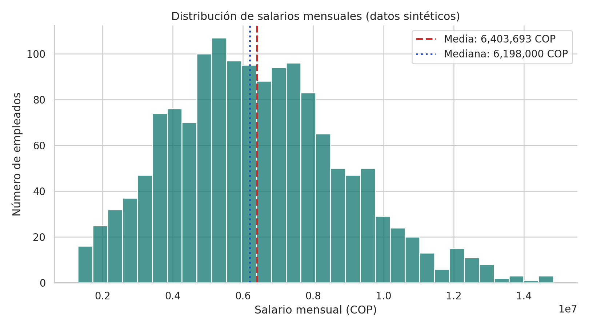
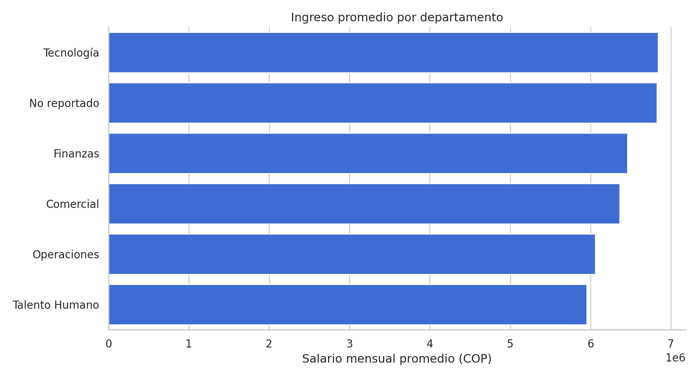
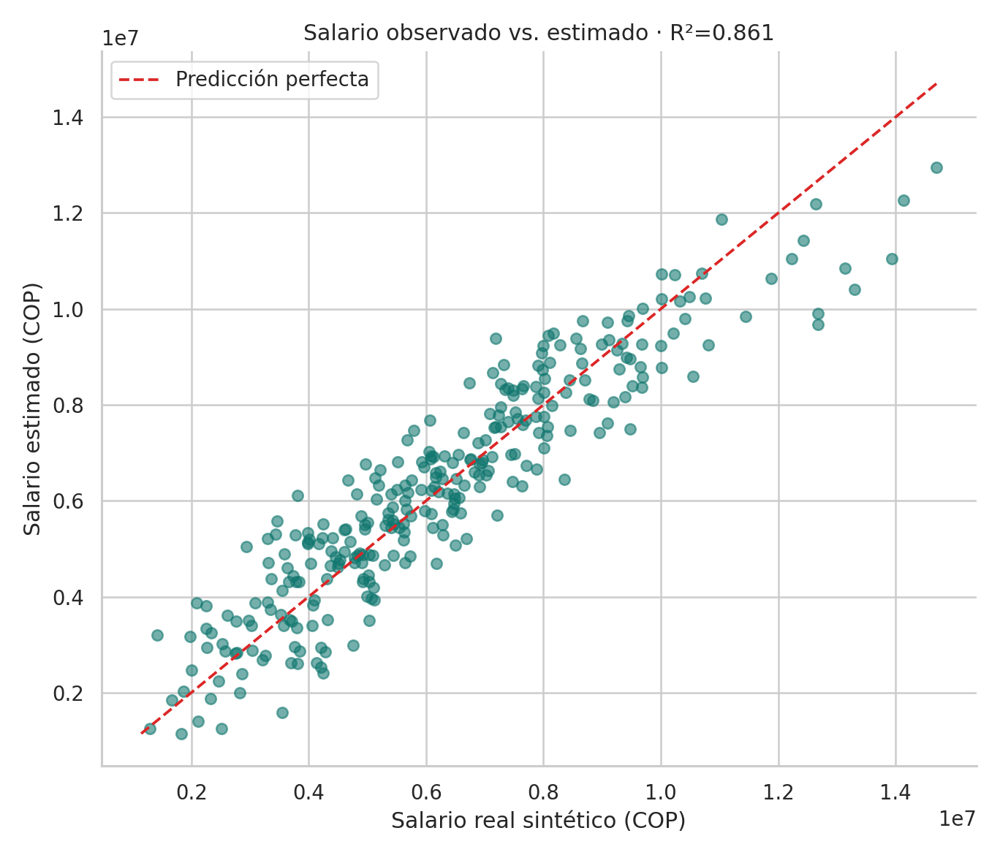

# Ciencia de Datos en Acción · Análisis y predicción de salarios

  

> **Proyecto final · Ingeniería de Sistemas**  
> **Integrantes (completar):** [Nombre completo del integrante 1] · [Nombre completo del integrante 2] · [Nombre del integrante 3, si aplica]  
> **Fecha límite del curso:** 21 de noviembre de 2026, 23:59 (según la consigna).

## 🎬 Video y presentación

- **[Ver video demostrativo MP4 (4 min 30 s)](video/VIDEO_DEMOSTRATIVO_VOZ_SINTETICA.mp4)**: presentación visual completa con **voz generada por computadora**. **NO es la grabación exigida al equipo.** Antes de entregar, sustituirla por un video de 2 a 5 minutos con las voces o intervención real de los 2 o 3 integrantes.
- **[Guion completo, repartido por integrantes](video/GUION_VIDEO_POR_INTEGRANTE.md)**.
- **[Presentación PowerPoint](presentacion/Proyecto_Final_Analisis_Salarios.pptx)** · **[Presentación PDF](presentacion/Proyecto_Final_Analisis_Salarios.pdf)**.
- **Enlace al video definitivo del equipo (rellenar):** `PENDIENTE_DE_GRABAR_Y_PUBLICAR`. Puede publicarse en el propio directorio `video/` o enlazarse aquí desde una plataforma con acceso público.

## 1. Introducción

Las organizaciones necesitan comprender la estructura de sus pagos y controlar la calidad de los datos de nómina. Este trabajo plantea la pregunta: **¿qué características laborales se relacionan con los salarios y qué tan bien puede una regresión lineal estimar el salario mensual de empleados simulados?**

La conexión con Ingeniería de Sistemas es el diseño de procesos completos de datos: ingestión, limpieza, análisis, automatización y comunicación. Como aplicación profesional imaginamos un tablero de planeación salarial alimentado por **extractos autorizados y anonimizados** de un sistema de RR. HH., como SAP HCM.

### Procedencia y límites de los datos

Los archivos `datos/empleados_original.csv` y `datos/empleados_depurados.csv` son **totalmente sintéticos**, producidos por `src/generar_datos.py` con semilla **202611**. No son datos reales de IBM, SAP, una organización colombiana o un grupo poblacional. Se construyeron deliberadamente errores, nulos, duplicados y etiquetas inconsistentes con fines de aprendizaje. Los salarios representan **COP ficticios** y no son un estudio de remuneraciones en Colombia.

**No corresponde usar este modelo para asignar remuneración real, evaluar personas o hacer inferencias causales.**

## 2. Etapa 1 · Exploración, calidad y depuración

- Dataset original: **1.514 registros** y **12 variables**.
- Problemas detectados: **14 duplicados exactos** y **16 registros** descartados por inconsistencias de edad o salario. Además se corrigieron categorías mal escritas y se imputaron valores faltantes de experiencia.
- Resultado: **1.484 registros depurados**, sin nulos, con esquema homogéneo.
- Tratamiento de extremos: los valores salariales estadísticamente inusuales que cumplen las reglas de calidad **se conservan** para no ocultar la variación.

El notebook explica por qué se toman estas decisiones y muestra código, ejemplos, conteos y verificaciones automáticas (`assert`).

## 3. Etapa 2 · Estadística descriptiva

| Medida / hallazgo | Resultado |
|:--|--:|
| Salario mensual medio (simulado) | **6.403.693 COP** |
| Salario mensual mediano (simulado) | **6.198.000 COP** |
| Desviación estándar salarial | **2.471.449 COP** |
| Salarios atípicos según IQR (conservados) | **12** |
| Correlación Pearson entre nivel de cargo y salario | **0,695** |
| Correlación Pearson entre experiencia y salario | **0,584** |

Se calculan también **moda, rango, varianza**, medidas para otras variables y comparaciones entre niveles y departamentos. Las relaciones observadas **no demuestran efectos causales**.

**Visualizaciones destacadas:**





Los demás gráficos (boxplot, correlación, experiencia-salario y residuos) están disponibles en `resultados/graficos/`.

## 4. Etapa 3 · Regresión lineal y storytelling

**Variable objetivo:** `SalarioMensualCOP`.

**Predictores:** `NivelCargo`, `ExperienciaAnios`, `AntiguedadAnios`, `Departamento`, `NivelEducativo`, `Ciudad`, `ModalidadTrabajo` y `HorasExtraMes`. Las variables categóricas pasan por One Hot Encoding y la imputación se entrena dentro del pipeline. El identificador no se utiliza para predecir.

**Evaluación:** separación aleatoria reproducible 80/20, 5 pliegues de validación cruzada solo sobre entrenamiento y comparación con un `DummyRegressor` que predice la mediana.

| Métrica sobre datos de prueba | Modelo base | Regresión lineal |
|:--|--:|--:|
| MAE | 2.059.364 COP | **764.628 COP** |
| RMSE | 2.578.546 COP | **963.004 COP** |
| R² | ≈0,000 | **0,861** |

En validación cruzada, el R² medio fue de **0,841**. El modelo es mejor que la línea base **en esta simulación**, pero no existe evidencia de rendimiento equivalente en nóminas reales. R² no debe presentarse como porcentaje de aciertos.

**Historia que contamos:**

1. Hay variación en los salarios; empezar por la media no es suficiente.
2. La distribución y las comparaciones revelan grupos y diferencias que requieren contexto.
3. La calidad del dato importa: duplicados y valores erróneos distorsionan el análisis.
4. Un modelo explicable puede anticipar valores sintéticos y cuantificar su error sobre datos no vistos.
5. Para aplicaciones reales hacen falta permisos, representatividad, validación humana y revisión de sesgos.

## 5. Estructura del proyecto

```text
proyecto_ciencia_datos_salarios/
├── README.md
├── CHECKLIST_ENTREGA.md
├── GUIA_PUBLICACION_GITHUB.md
├── requirements.txt
├── datos/
│   ├── empleados_original.csv
│   └── empleados_depurados.csv
├── notebook/
│   └── Proyecto_Final_Ciencia_Datos_Salarios.ipynb
├── presentacion/
│   ├── Proyecto_Final_Analisis_Salarios.pptx
│   └── Proyecto_Final_Analisis_Salarios.pdf
├── resultados/
│   ├── metricas_modelo.json
│   ├── estadisticas_descriptivas.csv
│   ├── resumen_departamentos.csv
│   ├── resumen_niveles.csv
│   ├── predicciones_prueba.csv
│   ├── RESUMEN_EJECUTIVO.md
│   └── graficos/ (7 gráficos PNG)
├── video/
│   ├── VIDEO_DEMOSTRATIVO_VOZ_SINTETICA.mp4
│   ├── GUION_VIDEO_POR_INTEGRANTE.md
│   └── INSTRUCCIONES_GRABACION.md
└── src/
    ├── generar_datos.py
    ├── crear_presentacion.py
    └── generar_video_demo.py
```

## 6. Cómo ejecutar en Google Colab o local

**Google Colab:**

1. Descarga el proyecto ZIP y descomprímelo en tu equipo.
2. Abre [Google Colab](https://colab.research.google.com/) y sube `notebook/Proyecto_Final_Ciencia_Datos_Salarios.ipynb`.
3. Ejecuta todas las celdas. Cuando Colab solicite `empleados_original.csv`, cárgalo desde `datos/`.
4. Colab mostrará los resultados y guardará nuevas salidas en la sesión. Para conservarlas, descarga los archivos generados.

**Local (recomendado si deseas regenerar todo):**

```bash
python -m venv .venv
# Activa el entorno virtual según Windows/macOS/Linux
pip install -r requirements.txt
python src/generar_datos.py
jupyter notebook notebook/Proyecto_Final_Ciencia_Datos_Salarios.ipynb
```

Luego usa **Run All**. Si quieres regenerar las diapositivas, instala `python-pptx` y ejecuta `python src/crear_presentacion.py`. Para el video demostrativo se necesitan además `ffmpeg`, `pdftoppm` y `espeak`.

## 7. Participación de los integrantes

| Integrante | Responsabilidad sugerida | Estado |
|--|--|--|
| [Nombre 1] | Etapa 1, limpieza y explicación de datos; narración de diapositivas 1–5 | Por confirmar |
| [Nombre 2] | Etapa 2, estadística; Etapa 3 y narración de diapositivas 6–11 | Por confirmar |
| [Nombre 3 opcional] | Visualizaciones, revisión crítica y sección final del video | Por confirmar |

Revisar y actualizar para reflejar **contribuciones reales del equipo** antes de publicar. El repositorio debe ser público y cada integrante entregar **la misma URL** en Canvas.

## 8. Reproducibilidad, ética y bibliografía

- Semillas fijas para datos (`202611`), división de entrenamiento y validación (`42`).
- Resultados numéricos guardados en `resultados/metricas_modelo.json` y gráficos en PNG.
- Herramientas principales: Python, NumPy, Pandas, Matplotlib, Seaborn y Scikit-learn.
- Documentación de referencia: [Pandas](https://pandas.pydata.org/docs/), [Scikit-learn](https://scikit-learn.org/stable/), [Matplotlib](https://matplotlib.org/stable/), [Google Colab](https://colab.research.google.com/).
- **Limitaciones**: simulación educativa, relaciones estadísticas no causales, falta de validación con población real, riesgos de sesgo y privacidad en una eventual aplicación empresarial.

**Entrega:** 21 de noviembre de 2026, 23:59, mediante Canvas. Verifica que todos los enlaces funcionen en una ventana de incógnito sin iniciar sesión.
