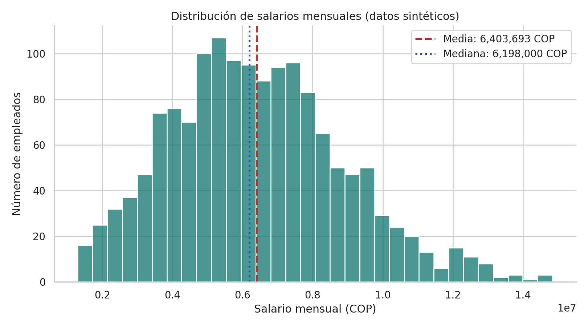
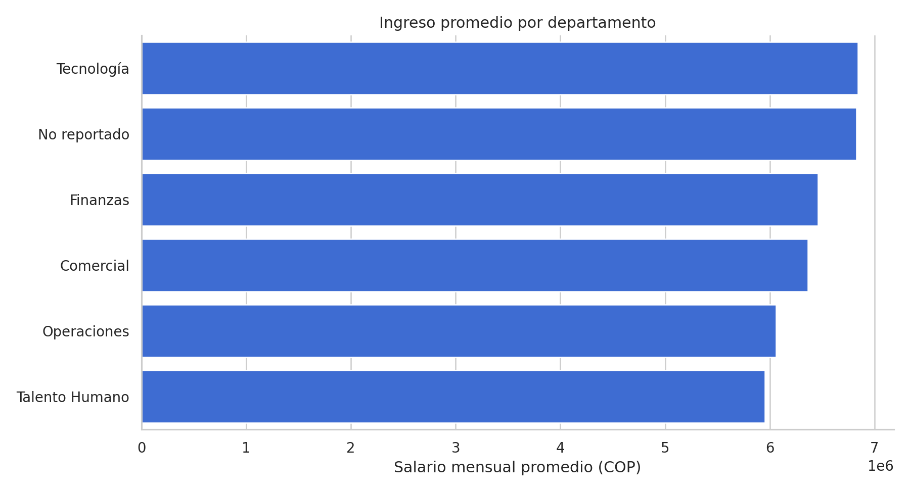
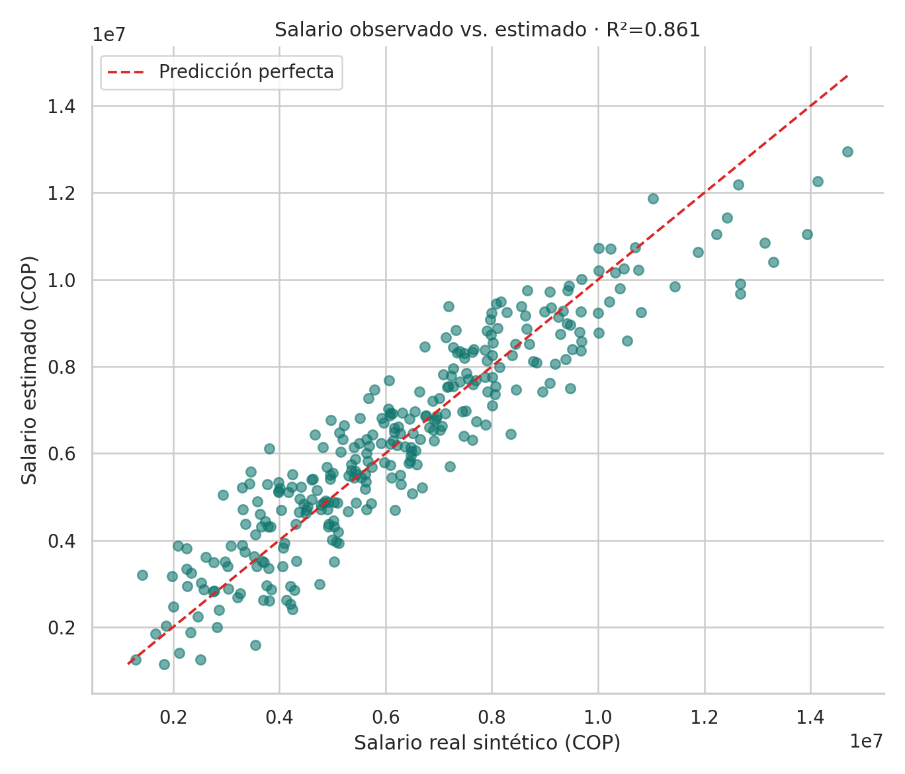

# Proyecto final de Ciencia de Datos
## Análisis y predicción de salarios

**Asignatura:** Ciencia de Datos  
**Programa:** Ingeniería de Sistemas  
**Estudiante:** Sebastián Manosalva Fonseca

## Descripción del proyecto

En este proyecto analizo cómo se relacionan algunas características laborales con el salario mensual de los empleados. Elegí el tema porque se relaciona con la Ingeniería de Sistemas y con el uso de la información en los procesos de recursos humanos y nómina.

Para desarrollar el ejercicio utilicé un conjunto de **datos sintéticos**, generado con Python para simular registros de empleados. No corresponde a información real de una empresa. El análisis está dividido en las tres etapas trabajadas en la asignatura.

## Etapa 1. Exploración y preparación de los datos

El conjunto inicial contiene **1.514 registros y 12 variables**, entre ellas salario, edad, experiencia, antigüedad, nivel de cargo y departamento.

Al revisar los datos encontré registros duplicados, valores faltantes y algunas inconsistencias. Eliminé **14 duplicados** y **16 registros con valores inválidos**. También corregí categorías e imputé datos faltantes de experiencia. Al finalizar, quedaron **1.484 registros depurados**, que utilicé para el análisis.

Los archivos están en la carpeta [datos](datos/) y el procedimiento de limpieza aparece en el [cuaderno de Google Colab](notebook/Proyecto_Final_Ciencia_Datos_Salarios.ipynb).

## Etapa 2. Estadística descriptiva

Calculé medidas de tendencia central y dispersión, como media, mediana, moda, rango, varianza y desviación estándar. También comparé los salarios según el departamento, el nivel de cargo y la experiencia laboral.

Estos fueron algunos resultados del conjunto de datos simulado:

| Indicador | Resultado |
|---|---:|
| Salario mensual promedio | $6.403.693 COP |
| Mediana salarial | $6.198.000 COP |
| Desviación estándar | $2.471.449 COP |
| Valores atípicos identificados con IQR | 12 |
| Correlación entre nivel de cargo y salario | 0,695 |
| Correlación entre experiencia y salario | 0,584 |

El promedio fue un poco mayor que la mediana. Esto indica que algunos salarios más altos influyen en el promedio general. Los gráficos permiten comparar mejor los datos y observar diferencias entre grupos.

## Etapa 3. Modelo predictivo y presentación de resultados

Para la última etapa entrené un modelo de **regresión lineal** con Python y Scikit-learn. El objetivo fue estimar el salario mensual a partir de variables como experiencia, antigüedad, nivel de cargo, departamento, educación y horas extras.

Separé los datos en entrenamiento (80 %) y prueba (20 %) para evaluar el modelo con registros que no se utilizaron al entrenarlo.

| Métrica del modelo | Resultado |
|---|---:|
| Error absoluto medio (MAE) | $764.628 COP |
| Raíz del error cuadrático medio (RMSE) | $963.012 COP |
| Coeficiente de determinación (R²) | 0,861 |

El resultado muestra que el modelo logró explicar una parte importante de la variación de los salarios **dentro de este conjunto sintético**. Sin embargo, sus predicciones tienen errores y no se deben trasladar directamente a empleados reales.

## Conclusiones y aplicación profesional

Este ejercicio me permitió aplicar un proceso de ciencia de datos desde la revisión y limpieza de la información hasta la construcción y evaluación de un modelo predictivo.

Considero que este tipo de análisis podría servir como apoyo en recursos humanos para identificar tendencias salariales, detectar posibles errores en los registros y crear reportes. En un entorno laboral real sería necesario contar con datos autorizados, proteger la información personal y evaluar el modelo antes de utilizar sus resultados.

## Archivos del proyecto

- **[Datos](datos/):** archivo original y archivo depurado en CSV.
- **[Cuaderno de Google Colab](notebook/Proyecto_Final_Ciencia_Datos_Salarios.ipynb):** código, estadísticas, visualizaciones y modelo.
- **[Presentación PDF](presentacion/Proyecto_Final_Analisis_Salarios.pdf)** y **[PowerPoint](presentacion/Proyecto_Final_Analisis_Salarios.pptx):** diapositivas de apoyo.
- **[Resultados](resultados/):** gráficos, tablas y métricas generadas.
- **[Video de presentación en YouTube](https://youtu.be/suOxmcwpM4Y):** sustentación del proyecto y explicación de las tres etapas.

## Cómo ejecutar el análisis

1. Abrir el [cuaderno](notebook/Proyecto_Final_Ciencia_Datos_Salarios.ipynb) en Google Colab.
2. Ejecutar las celdas en orden.
3. Cuando el cuaderno lo solicite, subir el archivo [empleados_original.csv](datos/empleados_original.csv).
4. Revisar los resultados estadísticos, los gráficos y las métricas del modelo.

**Herramientas utilizadas:** Python, Google Colab, Pandas, NumPy, Matplotlib, Seaborn y Scikit-learn.
